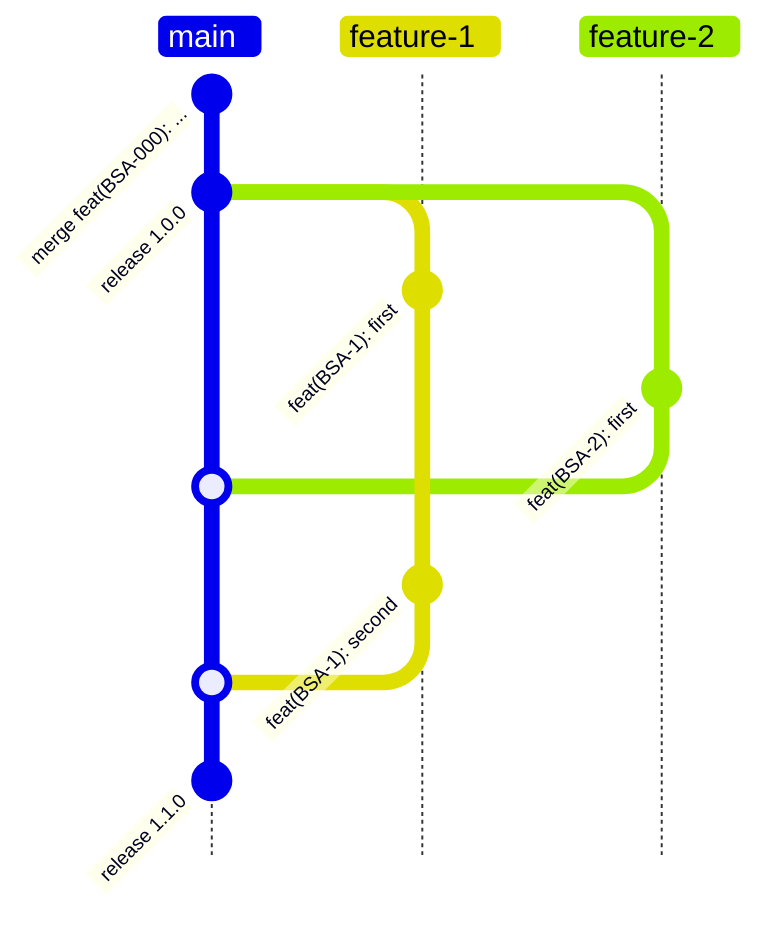

# 🚀 إصدار ونشر إصدار جديد من التطبيق

## 📌 الهدف

ضمان عملية إصدار شفافة ومنظمة حيث:

- يمكن لعدة مطورين العمل على الميزات في نفس الوقت
- جميع التغييرات تذهب إلى إصدار مشترك واحد (إصدار واحد)
- يتم تجنب تعارضات الإصدارات وفوضى العلامات



## إنشاء طلب السحب
1. إنشاء فرع جديد من الفرع الرئيسي
2. قم بإجراء التغييرات وتثبيتها برسائل وصفية واضحة (انظر قواعد رسائل الالتزام [هنا](https://www.conventionalcommits.org/en/v1.0.0/))
3. ادفع فرعك إلى المستودع (git push)
4. أنشئ طلب سحب بعنوان ووصف واضحين
   - مهم! اكتب CHANGELOG في وصف المهمة (كنا نكتبه سابقاً في ملف). انظر كيفية كتابة CHANGELOG [هنا](#changelog)
5. أضف المهمة إلى Milestone إذا كان يجب تضمينها في الإصدار التالي. للقيام بذلك، حدد علامة التبويب Milestone على اليمين في GitHub واختر الإصدار الذي يجب تضمين المهمة فيه

### متطلبات طلب السحب
- يجب أن تمر جميع الاختبارات
- يجب أن يتبع الكود دليل النمط الخاص بالمشروع
- يجب تحديث التوثيق إذا لزم الأمر
- يجب مراجعة التغييرات من قبل عضوين على الأقل من الفريق
- يجب إعداد CHANGELOG
- تعيين Milestone الحالي
- إذا كنت تقوم بتغييرات كاسرة (كود يكسر التوافق)، يجب إضافة ملف يصف كيفية الانتقال من إصدار إلى آخر. يجب أن يكون الملف في مجلد docs ويسمى MIGRATION.md. المزيد من المعلومات [هنا](#migration)

### عملية المراجعة (المطور)
1. انتظر مراجعة الكود
2. معالجة أي ملاحظات من المراجعين
3. تحديث طلب السحب حسب الحاجة
4. بعد الموافقة على طلب السحب، قم بدمج التغييرات أو انتظر حتى يقوم مدير الإصدار بذلك. يُحظر تماماً دمج المهام في main بدون تعيين milestone.

### عملية الإصدار (مدير الإصدار)
1. انتقل إلى علامة التبويب Milestone. يجب أن يكون Milestone مكتملاً بنسبة 100%.
2. إنشاء milestone جديد. على سبيل المثال، إذا كان milestone الحالي هو `1.0.0`، قم بإنشاء `1.0.1`، أي زيادة الإصدار الثانوي.
3. في حالة عدم اكتمال milestone:
   - نقل المهام غير المكتملة من milestone الحالي إلى التالي
   - انتظر حتى يتم دمجها
4. لا يُنصح بإضافة مهام جديدة إلى milestone أثناء الانتظار
5. يُحظر تماماً دمج المهام في main بدون تعيين milestone.

إذا كان Milestone مكتملاً بنسبة 100%، يبدأ مدير الإصدار البناء:
1. انتقل إلى Milestone، اذهب عبر جميع طلبات السحب واجمع CHANGELOG.md
2. تغيير الإصدار في main في `pubspec.yaml`، إضافة CHANGELOG. تغيير الإصدار ليس مسألة بسيطة، ولكن إليك الإرشادات:
   - رئيسي. تغييرات API غير متوافقة. لا يوجد توافق مع الإصدارات السابقة. ببساطة، هل يمكن استبدال هذا الإصدار في التطبيق وسيستمر في العمل بدون تغييرات
   - ثانوي. وظائف جديدة متوافقة مع الإصدارات السابقة
   - تصحيح. إصلاحات الأخطاء، إعادة الهيكلة، تحسينات للوظائف الموجودة
3. قم بالنشر عبر `flutter pub publish` أو `dart pub publish`
4. قم بعمل commit إلى الفرع الرئيسي مع الوصف `chore: release 1.0.0`
5. حذف milestone
6. تحديث ملف MIGRATION.md إذا لزم الأمر

## CHANGELOG
كتابة CHANGELOG مهمة مهمة لأنها تساعد في فهم ما تم تغييره في الإصدار الجديد.
مثال:
```
- [BSA-1234][RoadPanelEnabled] إضافة Dragger إلى eta
- [رقم المهمة][المكون أو الميزة] وصف التغيير
```

## MIGRATION

نتبع أسلوب توثيق الترحيل لفريق Flutter

[رابط الترحيل](docs/migration/MIGRATION.md)

[مثال على ترحيل محدد](https://docs.flutter.dev/release/breaking-changes/text-field-material-localizations)

[مثال على صفحة توثيق الترحيل](https://docs.flutter.dev/release/breaking-changes) 