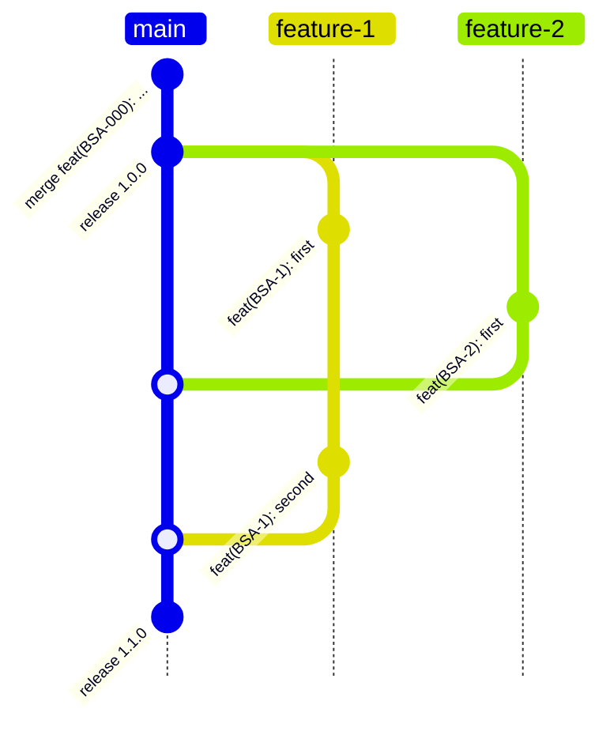

# 🚀 Versioning and Publishing New Application Version

## 📌 Purpose

To ensure a managed and transparent versioning process where:

- Multiple developers can simultaneously develop features
- All changes go into one shared release (one version)
- Version conflicts and tag chaos are avoided



## Creating a Pull Request
1. Create a new branch from the main branch
2. Make changes and commit them with clear commit messages (see commit message rules [here](https://www.conventionalcommits.org/en/v1.0.0/))
3. Push your branch to the repository (git push)
4. Create a Pull Request with a descriptive title and description
   - Important! Write the CHANGELOG in the task description (previously we wrote it in a file). See how to write CHANGELOG [here](#changelog)
5. Add the task to Milestone if it should be included in the next release. To do this, select the Milestone tab on the right in GitHub and choose the release where the task should be included

### Pull Request Requirements
- All tests must pass
- Code must follow the project's style guide
- Documentation must be updated if necessary
- Changes must be reviewed by at least two team members
- CHANGELOG must be prepared
- Set the current Milestone
- If you are making breaking changes (code that breaks compatibility), you must add a file describing how to migrate from one version to another. The file should be in the docs folder and named MIGRATION.md. More information [here](#migration)

### Review Process (Developer)
1. Wait for code review
2. Address feedback from reviewers
3. Update PR if necessary
4. After PR approval, merge changes or wait for the release manager to do it. It is strictly forbidden to merge tasks into main without a milestone set.

### Release Process (Release Manager)
1. Go to the Milestone tab. The Milestone should be 100% complete.
2. Create a new milestone. For example, if the current milestone was `1.0.0`, create `1.0.1`, that is, increment the minor version.
3. In case of incomplete milestone:
   - Move incomplete tasks from the current milestone to the next one
   - Wait for them to be merged
4. It is not recommended to add new tasks to the milestone while waiting
5. It is strictly forbidden to merge tasks into main without a milestone set.

If the Milestone is 100% complete, the release manager starts the build:
1. Go to Milestone, go through all PRs and collect CHANGELOG.md
2. Change the version in main in `pubspec.yaml`, add CHANGELOG. Version change is not a simple question, but here are the guidelines:
   - Major. Incompatible API changes. No backward compatibility. Simply put, can this version be substituted into the application and it will continue to work without changes
   - Minor. New functionality that is backward compatible
   - Patch. Bug fixes, refactoring, improvements to existing functionality
3. Make a publication via `flutter pub publish` or `dart pub publish`
4. Make a commit to the main branch with the description `chore: release 1.0.0`
5. Delete the milestone
6. Update MIGRATION.md file if necessary

## CHANGELOG
Writing CHANGELOG is an important task because it helps understand what has changed in the new release.
Example:
```
- [BSA-1234][RoadPanelEnabled] Add Dragger to the eta
- [Task number][Component or feature] Description of change
```

## MIGRATION

We follow the Flutter team's migration documentation style

[Migration link](docs/migration/MIGRATION.md)

[Example of specific migration](https://docs.flutter.dev/release/breaking-changes/text-field-material-localizations)

[Example of migration documentation page](https://docs.flutter.dev/release/breaking-changes)
