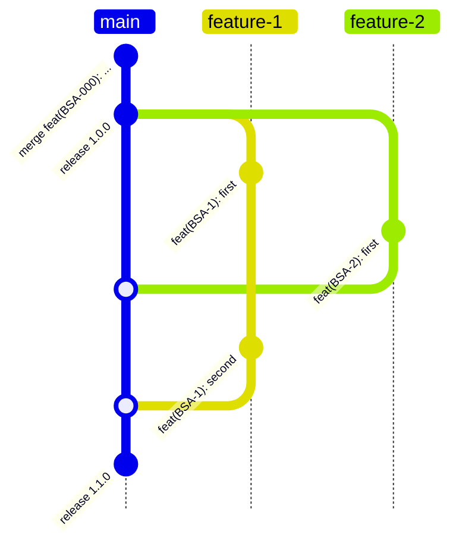

# 🚀 Версионирование и публикация новой версии приложения

## 📌 Цель

Обеспечить управляемый и прозрачный процесс версионирования, при котором:

- Несколько разработчиков могут одновременно разрабатывать фичи.
- Все изменения попадают в один совместный релиз (одна версия).
- Избегаются конфликты версий и хаос с тегами.




## Создание Pull Request
1. Создайте новую ветку от основной ветки main
2. Внесите изменения и зафиксируйте их с понятными сообщениями коммитов (правила написания коммитов [посмотрите тут](https://www.conventionalcommits.org/en/v1.0.0/))
3. Отправьте вашу ветку в репозиторий (git push)
4. Создайте Pull Request с описательным заголовком и описанием
   - Важно! Написать в описание задачи CHANGELOG (ранее мы его писали в файл). Как писать CHANGELOG смотрите [тут](#changelog)
5. Добавьте задачу в Milestone, если она должна попасть в следующий релиз. Для этого в GitHub справа выберете вкладку Milestone и выберите релиз, в который должна войти задача

### Требования к Pull Request
- Все тесты должны проходить
- Код должен соответствовать стилю проекта
- Документация должна быть обновлена при необходимости
- Изменения должны быть проверены как минимум двумя участником команды
- CHANGELOG должен быть составлен
- Поставить текущий Milestone
- Если вы вносите breaking changes (код, который ломает совместимость), необходимо добавить файл описание того, как перейти с одной версии на другую. Файл должен находиться в папке docs и называться MIGRATION.md. Больше информации [тут](#migration)

### Процесс проверки (разработчик)
1. Дождитесь проверки кода
2. Учтите отзывы рецензентов
3. Обновите PR при необходимости
4. После одобрения PR слейте изменения или подождите, пока это сделает ответственный за релиз. Категорически запрещено вливать в main задачи без проставленного milestone.

### Процесс релиза (ответственный за релиз)
1. Зайти во вкладку Milestone. Milestone должен быть выполнен на 100%.
2. Создать новый milestone. Например, если текущий milestone была `1.0.0`, то сделать `1.0.1`, то есть поднять на минимальную версию.
2. В случае невыполнения milestone:
    - Вынести невыполненные задачи из текущего milestone в следующий
    - Подождать, пока будет смерджен
3. В случае ожидания добавлять новые задачи в milestone не рекомендуется
4. Категорически запрещено вливать в main задачи без проставленного milestone.

Если Milestone выполнен на 100%, ответственный начинает сборку:
1. Зайти в Milestone, пройтись по всем PR'ам и собрать CHANGELOG.md
2. Поменять версию в main в `pubspec.yaml`, добавить CHANGELOG. мена версии непрстой вопрос, но вот ориентиры:
    - Мажорная. Несовместимые с новым API изменения. Нет обратной совместимости. Проще говоря, можно ли эту версию подставить в приложение и при этом оно продолжит работать без изменений
    - Минорная. Новая функциональность, которая обратно совместима
    - Патч. Фикс багов, рефакторинг, улучшения уже имеющегося функционала
3. Сделать публикацию через `flutter pub publish` или `dart pub publish`
4. Сделать коммит в main ветку с описанием `chore: release 1.0.0`
5. Удалить milestone
6. При необходимости обновить MIGRATION.md файл


## CHANGELOG
Написание CHANGELOG важная задача, потому что оно помогает понять, что было изменено в новом релизе.
Пример:
```
- [BSA-1234][RoadPanelEnabled] Add Dragger to the eta
- [Номер задачи][Компонент или фича] Описание изменения
```

## MIGRATION

Мы предерживемся стиля написания документа миграции Flutter команды

[Ссылка на миграцию](docs/migration/MIGRATION.md)

[Пример конкретной миграции](https://docs.flutter.dev/release/breaking-changes/text-field-material-localizations)

[Пример страницы с описанием миграций](https://docs.flutter.dev/release/breaking-changes)
